# The minimal harmonic energy of 9 points on S³

This repository contains a Lean 4 formalization of the solution to the minimization problem of the harmonic energy of
$N=9$ points on the sphere $S^3$. The main theorem says that a regular pentagon on a great circle
together with a square on the orthogonal great circle is the unique minimizer of the harmonic
energy, and that the minimal energy is $\frac{35}{2}$.



## Preliminaries

The *harmonic energy* of a configuration $Y=(y_1,\ldots,y_9)$ of nine distinct points on the unit
sphere $S^3\subset\mathbb{R}^4$ is

```math
E(Y)=\sum_{1\le i\lt j\le 9}\frac{1}{\lVert y_i-y_j\rVert^{2}}.
```

It is the electrostatic energy of unit charges at the points of $Y$: the potential of a point
charge in $\mathbb{R}^4$ is proportional to $1/r^2$.

In what follows, let $X=(x_1,\ldots,x_9)$ be the configuration that consists of the five points

```math
\Bigl(\cos\tfrac{2\pi k}{5},\ \sin\tfrac{2\pi k}{5},\ 0,\ 0\Bigr),\qquad k=0,\ldots,4,
```

and of the four points $(0,0,\pm1,0)$ and $(0,0,0,\pm1)$: a regular pentagon on a great circle,
and a square on the great circle of the orthogonal plane.

## Formalized theorem

**Theorem.** The configuration $X$ from above has the following properties:

1. Every configuration $Y$ of 9 distinct points on $S^3$ satisfies $E(Y)\ge E(X)$, with equality
   if and only if $Y$ arises from $X$ by an orthogonal transformation and a relabelling of the
   points.
2. The minimal energy is $E(X)=\frac{35}{2}$.

`harmonic_energy_9_points_S3` is the Lean formulation of this theorem. The following declaration
is from [Showcase.lean](Showcase.lean), which contains all definitions that the statement uses and
imports only Mathlib.

```lean
theorem harmonic_energy_9_points_S3 :
    IsUniqueMinimizer X ∧ E X = 35 / 2
```

<table><tr><td>

**Dependencies:** The proof of `harmonic_energy_9_points_S3` in
[Showcase_WithProofs.lean](Showcase_WithProofs.lean) compiles and depends only on `propext`,
`Classical.choice` and `Quot.sound`.

</td></tr></table>

## Lean entry points

- [Showcase.lean](Showcase.lean): the definitions and the statement of the theorem, with `sorry`
  in place of the proof. Mathlib is its only import.
- [Showcase_WithProofs.lean](Showcase_WithProofs.lean): the same definitions and the same
  statement with the complete proof, followed by a test of its axioms.
- [LeanCode/S3N9/Statement.lean](LeanCode/S3N9/Statement.lean): the theorem in the coordinates of
  the proof, `S3N9.Harmonic9`.
- [Certificates/Typed/T8S.lean](Certificates/Typed/T8S.lean),
  [Certificates/VirtualRoot/T8VS.lean](Certificates/VirtualRoot/T8VS.lean) and
  [Certificates/Sharp/I3S.lean](Certificates/Sharp/I3S.lean): the statements that the proof takes
  from its certificates, for example `T8N.W0.energy_claim0`, `T8V.QW0.energy` and
  `T8X.I3.contacts`.
- [Certificates/Theorem/T8A.lean](Certificates/Theorem/T8A.lean): the theorem
  `T8A.harmonic9 : S3N9.Harmonic9`.
- [LeanCode/S3N9/Equality.lean](LeanCode/S3N9/Equality.lean): the analytic part,
  `S3N9.harmonic9_of`.
- [comparator.json](comparator.json): Comparator configuration for the theorem and its
  definitions in the two showcase files.

## Repository layout

| Path | Contents |
| --- | --- |
| [Showcase.lean](Showcase.lean) | The statement of the main theorem, self-contained on the basis of Mathlib. |
| [Showcase_WithProofs.lean](Showcase_WithProofs.lean) | The same statement with its proof. |
| [Certificates](Certificates) | The numerical certificates: 406 Lean modules with exact data, the kernel checks and the statements that follow from them. |
| [AnalyticArguments](AnalyticArguments) | The proof in the form that Lean verifies (TeX and PDF): the theorem, the statements that Lean takes from the certificates, and the analytic arguments. |
| [LeanCode](LeanCode) | The Lean code of the verification: statement, checkers, soundness theorems, analytic part. |
| [Visualization](Visualization) | The animation above, an SVG file of 68 kB, and the program that writes it. |
| [lakefile.toml](lakefile.toml), [lake-manifest.json](lake-manifest.json), [lean-toolchain](lean-toolchain) | The Lake project. They pin Lean 4.33.0 and the revision of Mathlib. |

## Building

The project uses Lean 4.33.0. The dependencies are pinned in
[lake-manifest.json](lake-manifest.json). To compile the library, the certificates and both
showcase files, run

```sh
lake exe cache get
LEAN_NUM_THREADS=8 lake build
```

`Showcase.lean` produces one expected `sorry` warning. `LEAN_NUM_THREADS` is the number of
modules compiled at a time. With these settings, a complete build on Linux compiles the 487
modules of this repository on top of Mathlib in 2.5 minutes, which are 18 minutes of CPU time. It
needs up to 16 GB of memory, 10 GB of them for the largest module, and the `.lake` directory needs
about 8 GB of disk space.
